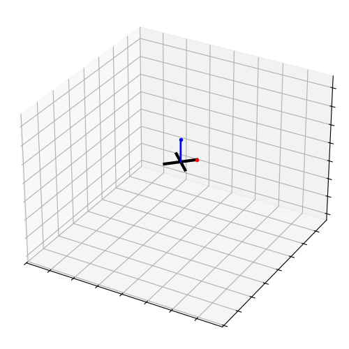
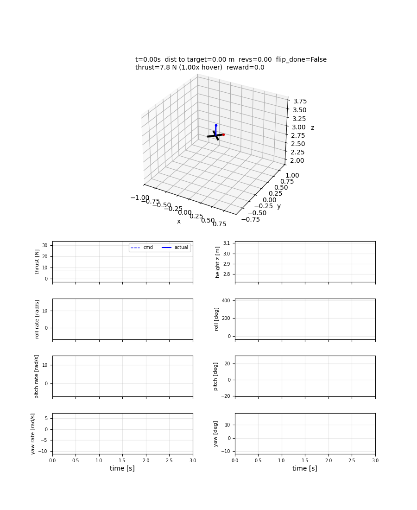
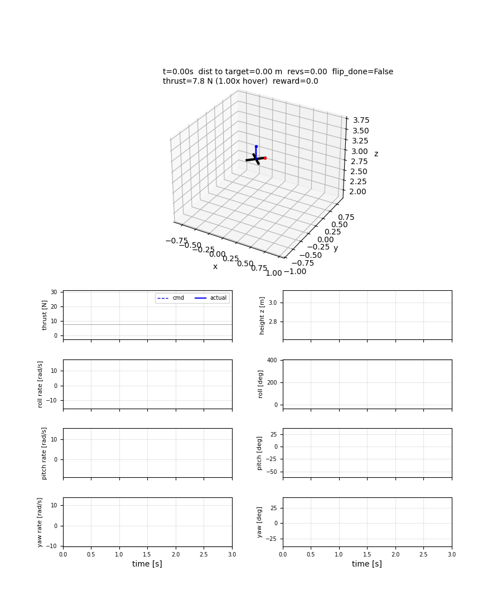
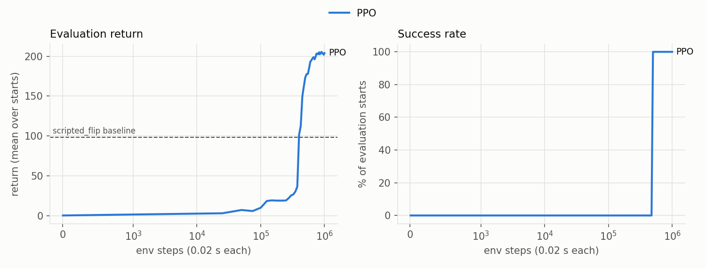

# quadrotor-flip-rl

Teaching a simulated quadrotor to do a flip with reinforcement learning: one roll flip, then recover to level. Comparison between PPO and TD-MPC2.

## Results

TD-MPC2 is shown twice: acting with MPPI planning (the actual algorithm), and with its learned policy alone (no planning, same model).

<table>
  <tr><th>PPO</th><th>TD-MPC2 (MPPI)</th><th>TD-MPC2 (no plan)</th></tr>
  <tr>
    <td></td>
    <td></td>
    <td></td>
  </tr>
</table>



Each algorithm was trained with 3 seeds. The curves show the mean over the seeds, with a band of ± 1 std. The GIFs and the table are from seed 0, except the two rows marked "all 3 seeds".


| | PPO | TD-MPC2 (MPPI) | TD-MPC2 (no plan) |
|---|---|---|---|
| Total episode reward | 204 | 173 | 194 |
| Final distance to start point | 0.07 m | 0.13 m | 0.14 m |
| Speed, last 0.5 s | 0.001 m/s | 0.14 m/s | 0.009 m/s |
| Env steps to first reach total reward 150 | 475k | 75k | 70k |
| Total episode reward, all 3 seeds (mean ± std) | 205 ± 1 | 184 ± 10 | 189 ± 6 |
| Env steps to first reach 150, all 3 seeds (mean ± std) | 492k ± 14k | 58k ± 14k | 53k ± 15k |
| Training steps / wall-clock time | 1M / 23 min | 200k / 3.4 h | (same run) |
| Model size (trained parameters) | 40k | 331k | (same model) |
| Inference time per step, median (p99) | 0.2 ms (0.5 ms) | 16 ms (20 ms) | 0.4 ms (0.5 ms) |

TD-MPC2 learns the flip with about 9× fewer env steps. PPO needs far more env steps but much less wall-clock time, finishes with a higher total episode reward.

Total episode reward is the sum of the per-step rewards over one evaluation episode (no discounting), averaged over 5 fixed starts. The table uses each run's last evaluation (TD-MPC2's is at 195k steps).

Inference time is the wall-clock time to compute one action from one observation, on a laptop CPU (Intel i7-1065G7, PyTorch CPU build, batch size 1).

## Setup

```bash
python3 -m venv .venv
source .venv/bin/activate

# CPU-only PyTorch (much smaller than the default CUDA build)
pip install --upgrade pip
pip install torch --index-url https://download.pytorch.org/whl/cpu
pip install -r requirements.txt

# check that everything imports
python -c "import gymnasium, stable_baselines3, torch, matplotlib; print('ok', torch.__version__)"
```

## Usage

```bash
# Train (algorithm settings in configs/ppo.yaml and configs/tdmpc2.yaml; env and rewards in configs/env.yaml)
python -m ppo.train_ppo                                     # saves models/ppo_flip.zip
python -m tdmpc2.train_tdmpc2                               # saves models/tdmpc2_flip.pt
python -m ppo.train_ppo env.reward.smooth=0.3 name=test     # an experiment: any config value can be overridden

# watch training curves
tensorboard --logdir runs

# learning curves: total episode reward vs env steps, from the logs both trainers write
python plot_curves.py

# watch a model: policy is zero, hover, random, scripted_hover, scripted_flip, or any model in models/ (ppo_*, tdmpc2_*)
python animate_rollout.py policy=ppo_flip
python animate_rollout.py policy=tdmpc2_flip plan=false save=plots/flip.gif
```

There is also a `hover` task (hold a point, starting from a perturbed state). It trains in minutes, so it is a quick sanity check for the env and the algorithms: `python -m ppo.train_ppo task=hover steps=300000`, then `python animate_rollout.py policy=ppo_hover`.

## Checkpoints and fine-tuning

Training saves the model every `save_every` env steps (`configs/ppo.yaml`: 100k, `configs/tdmpc2.yaml`: 5k), not only at the end or on Ctrl-C. It writes the usual model file, so you can check progress while training continues, with the usual commands:

```bash
python animate_rollout.py policy=tdmpc2_flip plan=false     # latest checkpoint of a running TD-MPC2 flip run
python plot_curves.py                                       # learning curves so far (results/ is written every eval_every steps)
```

Fine-tuning an existing model is supported for PPO:

```bash
python -m ppo.train_ppo name=ppo_flip_test    # experiment: saves models/ppo_flip_test.zip, main model untouched
python -m ppo.train_ppo init_model=models/ppo_flip.zip steps=500000 env.reward.speed=0.3    # fine-tune: continue from a saved model with changed settings
```

## License

[PolyForm Noncommercial 1.0.0](LICENSE): free for any noncommercial use (personal projects, study, hobby, noncommercial research). Commercial use is not permitted. Copyright (c) 2026 Ali Hawater.
