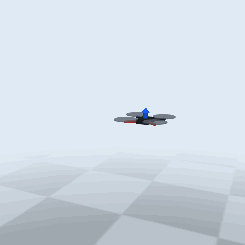
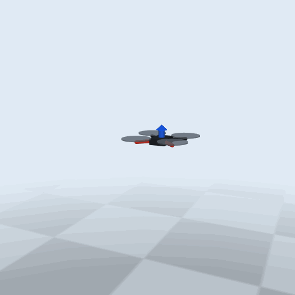
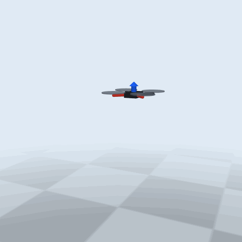
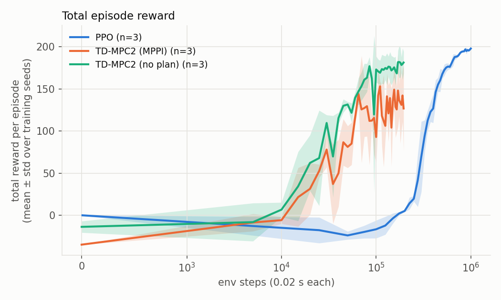

# quadrotor-flip-rl

Teaching a simulated quadrotor to do a flip with reinforcement learning: one roll flip, then recover to level. Comparison between PPO and TD-MPC2.

## Results

TD-MPC2 is shown twice: acting with MPPI planning (the actual algorithm), and with its learned policy alone (no planning, same model).

<table>
  <tr><th>PPO</th><th>TD-MPC2 (MPPI)</th><th>TD-MPC2 (no plan)</th></tr>
  <tr>
    <td></td>
    <td></td>
    <td></td>
  </tr>
</table>



Each algorithm was trained with 3 seeds. The curves show the mean over the seeds, with a band of ± 1 std. The GIFs and the table are from seed 0, except the two rows marked "all 3 seeds".


| | PPO | TD-MPC2 (MPPI) | TD-MPC2 (no plan) |
|---|---|---|---|
| Total episode reward | 198 | 133 | 167 |
| Final distance to start point | 0.06 m | 0.25 m | 0.42 m |
| Speed, last 0.5 s | 0.008 m/s | 0.62 m/s | 0.18 m/s |
| Env steps to first reach total reward 150 | 450k | 190k | 85k |
| Total episode reward, all 3 seeds (mean ± std) | 198 ± 1 | 127 ± 51 | 181 ± 13 |
| Env steps to first reach 150, all 3 seeds (mean ± std) | 458k ± 38k | 108k ± 71k | 72k ± 12k |
| Training steps / wall-clock time | 1M / 23 min | 200k / 2.5 h | (same run) |
| Model size (trained parameters) | 40k | 331k | (same model) |
| Inference time per step, median (p99) | 0.3 ms (0.8 ms) | 22 ms (27 ms) | 0.6 ms (1.3 ms) |

TD-MPC2's learned policy reaches a total episode reward of 150 with about 6× fewer env steps than PPO. PPO needs much less wall-clock time, finishes with the highest total episode reward, and its 3 seeds are nearly identical.

MPPI planning makes TD-MPC2 worse on this simulator: it scores below the learned policy alone on all 3 seeds. Without the motor model (git tag `custom-sim-v1`), the two were close:

| Total episode reward, all 3 seeds | PPO | TD-MPC2 (MPPI) | TD-MPC2 (no plan) |
|---|---|---|---|
| Without the motor model | 205 ± 1 | 184 ± 10 | 189 ± 6 |
| With the motor model | 198 ± 1 | 127 ± 51 | 181 ± 13 |

The cause is not established. One lead, not yet tested: MPPI's actions change about 10× more from step to step than the policy's, and the motors can't deliver the requested roll and pitch torque on 55-78% of its steps, against 10-18% for the policy alone.

Total episode reward is the sum of the per-step rewards over one evaluation episode (no discounting), averaged over 5 fixed starts. The table uses each run's last evaluation (TD-MPC2's is at 195k steps).

Five starts are few for MPPI, so the final models were also run on 20 starts each. Mean ± std over the 3 seeds: PPO 199 ± 1, TD-MPC2 with MPPI 126 ± 30, TD-MPC2 with no plan 181 ± 11. All of them completed the flip every time. MPPI crashed in 35% of episodes on seed 1 and never on the other two seeds; PPO and the policy alone never crashed.

The GIFs show seed 0, from rest. The MPPI GIF (total reward 150) is the best of 12 episodes from the same start that differed only in MPPI's random samples, which gave 127 ± 13 (range 106 to 150).

Inference time is the wall-clock time to compute one action from one observation, on a laptop CPU (Intel i7-1065G7, PyTorch CPU build, batch size 1). At 22 ms, MPPI takes slightly longer than the 20 ms control period on this CPU.

## Simulator

The drone is simulated in [MuJoCo](https://mujoco.org). The policy commands collective thrust and body rates at 50 Hz. A 500 Hz rate controller and a mixer turn these into thrust commands for four motors, each with a 30 ms lag and a 7.85 N limit.

When the motors can't deliver everything, the priority is collective thrust, then roll and pitch, then yaw. This means thrust and roll torque compete during the flip: there is no torque at zero thrust, and the most is at twice hover thrust.

Not modelled: drag, ground contact (episodes end above the floor), the battery, propeller speed and rotor inertia.

## Setup

```bash
python3 -m venv .venv    # Python 3.10
source .venv/bin/activate

# CPU-only PyTorch (much smaller than the default CUDA build)
pip install --upgrade pip
pip install torch==2.14.1 --index-url https://download.pytorch.org/whl/cpu
pip install -r requirements.txt

# check that everything imports
python -c "import gymnasium, mujoco, stable_baselines3, torch, matplotlib; print('ok', torch.__version__)"
```

## Usage

```bash
# Train (algorithm settings in configs/ppo.yaml and configs/tdmpc2.yaml; env and rewards in configs/env.yaml)
python -m ppo.train_ppo                                     # saves models/ppo_flip.zip
python -m tdmpc2.train_tdmpc2                               # saves models/tdmpc2_flip.pt
python -m ppo.train_ppo env.reward.smooth=0.3 name=test     # an experiment: any config value can be overridden

# watch training curves
tensorboard --logdir runs

# learning curves: total episode reward vs env steps, from the logs both trainers write
python plot_curves.py

# watch a model: policy is zero, hover, random, scripted_hover, scripted_flip, or any model in models/ (ppo_*, tdmpc2_*)
python animate_rollout.py policy=ppo_flip
python animate_rollout.py policy=tdmpc2_flip plan=false save=plots/flip.gif
```

There is also a `hover` task (hold a point, starting from a perturbed state). It trains in minutes, so it is a quick sanity check for the env and the algorithms: `python -m ppo.train_ppo task=hover steps=300000`, then `python animate_rollout.py policy=ppo_hover`.

## Reproducing the results

[reproduce.sh](reproduce.sh) trains both algorithms on 3 seeds (~8.5 h on a laptop CPU), then writes the figure and the GIFs (from seed 0) to `docs/`:

```bash
./reproduce.sh                   # train, then figure and GIFs
./reproduce.sh --skip-training   # figure and GIFs only, from the models in models/
```

The evaluation logs of these runs are in `results/`, so `python plot_curves.py` works without retraining.

## Checkpoints and fine-tuning

Training saves the model every `save_every` env steps (`configs/ppo.yaml`: 100k, `configs/tdmpc2.yaml`: 5k), not only at the end or on Ctrl-C. It writes the usual model file, so you can check progress while training continues, with the usual commands:

```bash
python animate_rollout.py policy=tdmpc2_flip plan=false     # latest checkpoint of a running TD-MPC2 flip run
python plot_curves.py                                       # learning curves so far (results/ is written every eval_every steps)
```

Fine-tuning an existing model is supported for PPO:

```bash
python -m ppo.train_ppo name=ppo_flip_test    # experiment: saves models/ppo_flip_test.zip, main model untouched
python -m ppo.train_ppo init_model=models/ppo_flip.zip steps=500000 env.reward.speed=0.3    # fine-tune: continue from a saved model with changed settings
```

## License

[PolyForm Noncommercial 1.0.0](LICENSE): free for any noncommercial use (personal projects, study, hobby, noncommercial research). Commercial use is not permitted. Copyright (c) 2026 Ali Hawater.
